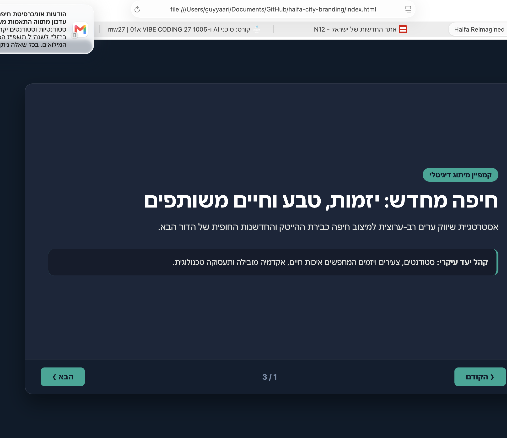
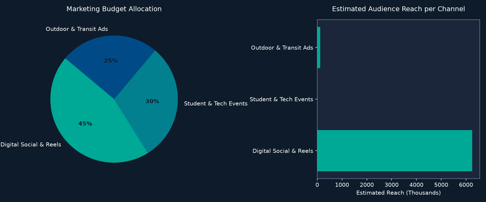

# חיפה מחדש | Haifa Reimagined - Campaign & Digital Presentation

פרויקט אקדמי לפיתוח קמפיין שיווק ומיתוג עירוני רב-ערוצי לעיר חיפה. הפרויקט משלב מצגת דיגיטלית אינטראקטיבית ב-HTML5/CSS3 (תמיכה מלאה ב-RTL ובקרת שקפים), הדמיית מרחב עירוני בתלת-ממד, ומנוע חישוב ואנליטיקה מבוסס Python לניהול תקציב, יעדי חשיפה ומדדי ביצוע (KPIs).

---

## 📸 המחשות ויזואליות מתוך הפרויקט

### 1. תצוגת המצגת הדיגיטלית (Interactive Presentation UI)


### 2. תרשים ניתוח ביצועים ותקציב (Python Analytics Output)


---

## 📌 מבנה הפרויקט

```text
haifa-city-branding/
├── index.html                    # מצגת דיגיטלית אינטראקטיבית (HTML5/CSS3/JS)
├── main.py                       # מנוע אנליטי ב-Python לחישוב תקציב, חשיפה ותרשימי ביצועים
├── campaign_analytics_chart.png  # תרשים ויזואלי מיוצא (נוצר אוטומטית ע"י Matplotlib)
├── presentation_screenshot.png   # צילום מסך של ממשק המצגת
├── campaign_metrics.json         # נתוני KPIs מובנים בפורמט JSON
├── PRD.md                        # מסמך דרישות פרויקט (Product Requirements Document)
├── README.md                     # מדריך הפרויקט והוראות הרצה
└── prompts/
    └── prompt_history.md         # תיעוד הנחיות ופרומפטים ששימשו לפיתוח